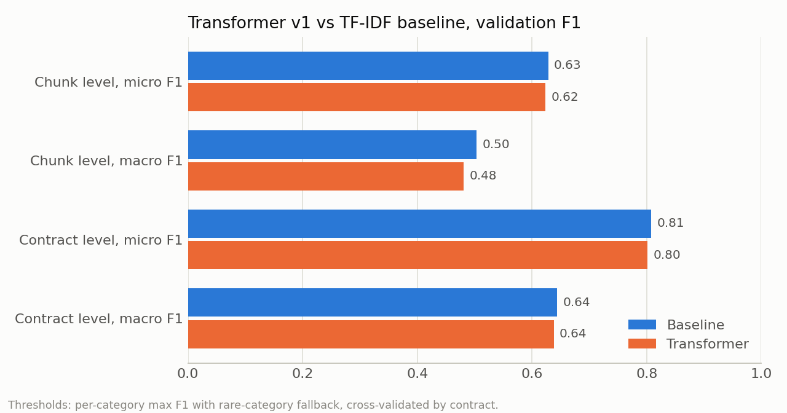
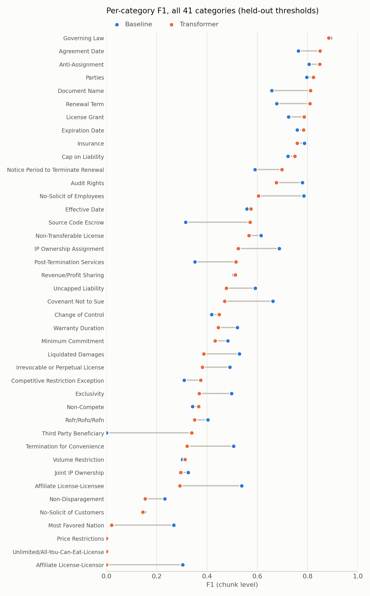
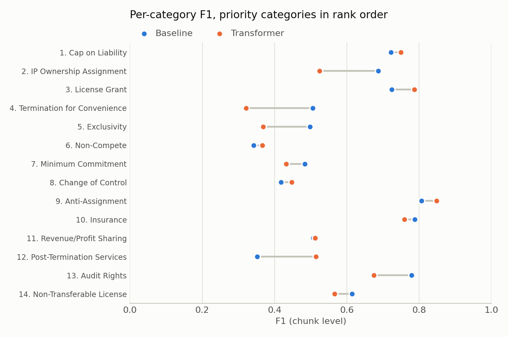

# Evaluation: transformer v1 vs TF-IDF baseline

Both models are scored on the same 2,317 validation chunks (84 contracts, 41 categories) with the same threshold rule from the threshold experiments: per-category max-F1 thresholds, with one global threshold for categories that have fewer than 10 positive chunks.

The headline numbers are **held-out**. Each contract is scored with thresholds fitted on the other contracts (5 folds × 5 repeats), so no threshold is tuned on the chunks it is scored on. Numbers with thresholds tuned on all of validation are in `metrics_table.md` for comparison with earlier results. They run about 0.03–0.05 F1 higher. The test set has not been used.

Reproduce with `python scripts/evaluate.py`. The first run retrains the baseline (about 1–2 minutes) to save its validation predictions.

## Headline

| | Chunk micro F1 | Chunk macro F1 | Contract micro F1 | Contract macro F1 |
|---|---|---|---|---|
| Baseline | 0.628 | 0.503 | 0.808 | 0.644 |
| Transformer v1 | 0.623 | 0.481 | 0.801 | 0.638 |

**The transformer has not yet beaten the baseline.** The two models are within about 0.02 F1 on every overall metric. The baseline is slightly ahead, most clearly on chunk-level macro F1, which weights rare categories equally. The threshold-free comparison agrees: the transformer's macro average precision is 0.514, against the baseline's 0.551. Its average precision is higher in only 12 of 41 categories.

The transformer does find more clauses at contract level: macro recall is 0.664, against the baseline's 0.635. But it loses that gain in precision.

## Per category

At chunk level, the transformer is better in 16 categories, worse in 19 and within ±0.01 F1 in 6.

- **Transformer better:** Document Name, Renewal Term, Agreement Date, Notice Period to Terminate Renewal, Post-Termination Services, License Grant, Anti-Assignment. Source Code Escrow and Third Party Beneficiary also improved, but they have only 5–6 positive chunks, so treat those gains as noise.
- **Transformer worse:** Affiliate License-Licensee and -Licensor, Most Favored Nation, Termination for Convenience, IP Ownership Assignment, Covenant Not to Sue, No-Solicit of Employees, Exclusivity, Liquidated Damages, Audit Rights.
- **Both near zero:** Price Restrictions and Unlimited/All-You-Can-Eat-License have 3 and 5 positive chunks, too few to learn or measure.

## Priority categories

These are the 14 shortlisted categories from the EDA, in the team's preliminary priority order (`priority_categories.csv`). The order may still change. For a reviewer, missing a high-priority clause costs more than a false alarm, so recall matters most here.

- **#1 Cap on Liability** is strong for both models: contract-level F1 is 0.95 for each, and recall is about 0.92.
- **The transformer is clearly worse on four of the top seven: #2 IP Ownership Assignment** (chunk F1 0.52 vs 0.69, contract recall 0.76 vs 0.90), **#4 Termination for Convenience**, **#5 Exclusivity** and **#7 Minimum Commitment**. These are the main gap to close.
- **The transformer is better on #3 License Grant, #6 Non-Compete** (contract recall 0.73 vs 0.52), **#8 Change of Control**, **#9 Anti-Assignment** and **#12 Post-Termination Services**.

## Suggestions for error analysis and improvement

1. Start error analysis with the four top-seven categories where the transformer is worse. `results/transformer_v1/val_predictions.csv` and `baseline_val_predictions.csv` (in this folder) have each chunk's scores and labels, so the chunks the transformer misses can be pulled up and read.
2. BERT only sees the first 510 tokens of each 512-token chunk, and long clauses are split across chunks. Check whether misses cluster at chunk boundaries.
3. Experiments that don't need retraining, and so can finish quickly: the recall-oriented thresholds from the threshold experiments, applied to the top-ranked categories only; and averaging the two models' probabilities. The two models win on different categories, so an average may beat both.

## Notes

- Held-out numbers differ from the threshold experiments table by about 0.001–0.004. Rows are sorted by contract and chunk here, which changes which contracts land in which fold.
- Contract-level labels and predictions follow the rule in the threshold experiments: a contract counts as positive if any of its chunks is.

